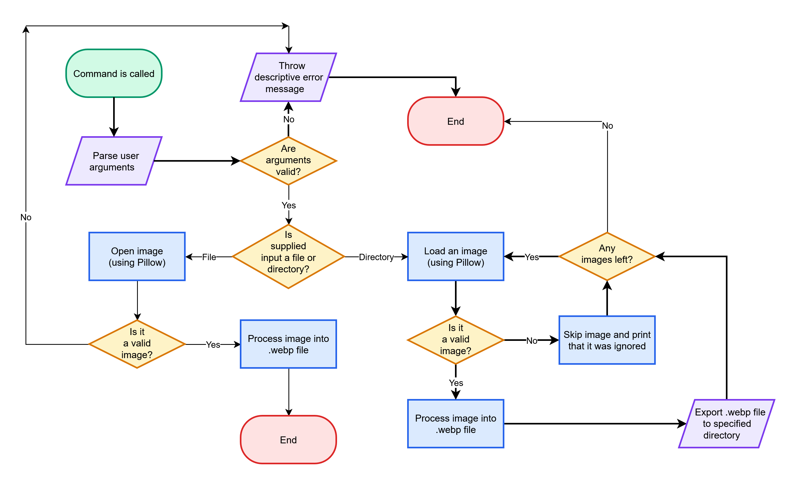

# imagetowebp

A CLI tool that helps you convert images files to the .webp format.

## The Problem

When making websites, it is good to add images because the add a bit of life to the website. However, most image formats are not optimized for the web and take a long time to load. This project aims to solve this problem by creating a cli tool that converts image files to the .webp format, which is optimized for websites.

## How it works

1. The program will first check whether arguments are valid
2. The program will then check if the input is a file or directory
3. If it is a file, it will attempt to process the file
4. If it is a directory, it will attempt to process all files in the directory



## Tech Stack

- VS Code
- Python 3.14
  - pillow Library
  - argparse library
- uv Python package and project manager

## How to install

Rather than cloning this repository, this tool can be installed using `pipx` and ran directly through the command line.

1. Install Python version 3.14 or greater from [https://www.python.org/downloads/](https://www.python.org/downloads/) or through the command line.
2. Install git from here [https://git-scm.com/install/](https://git-scm.com/install/)
3. Use pip to install pipx and use pipx to install imagetowebp.

### Windows

```bash
pip install pipx
python -m pipx ensurepath
python -m pipx install git+https://github.com/101zh/imagetowebp.git
```

### Linux

```bash
# Might need to run `sudo apt update` or `sudo add-apt-repository universe`
sudo apt install pipx
pipx ensurepath
pipx install git+https://github.com/101zh/imagetowebp.git
```

### Mac

1. Also install brew from [https://brew.sh/](https://brew.sh/)

```bash
brew install pipx
pipx ensurepath
pipx install git+https://github.com/101zh/imagetowebp.git
```

## How to Use imagetowebp

1. Use the help command to view all the options

```bash
imagetowebp -h
```

2. If you want to convert a **singular** image into the .webp format, use the following command

```bash
imagetowebp .\path\to\photo.png
```

Output Example:

```text
Working on "path\to\photo.png"
Finished converting "path\to\photo.png"
All Done!
```

3. If you want to convert a **directory** of images into the .webp format, use the following command. (Both commands are the same it is just whether you pass in a folder or file)

```bash
imagetowebp .\path\to\photosfolder\
```

Output Example:

```text
Working on "path\to\photosfolder\photo1.png"
Working on "path\to\photosfolder\photo2.jpg"
Working on "path\to\photosfolder\animation.gif"
"path\to\photosfolder\story.txt" cannot be identified as an image, it is being ignored
"path\to\photosfolder\data.json" cannot be identified as an image, it is being ignored
Finished converting "path\to\photosfolder\photo1.png"
Finished converting "path\to\photosfolder\photo2.jpg"
Finished converting "path\to\photosfolder\animation.gif"
All Done!
```

4. There are other flags that can be used to alter the how the processing of image files is done, which can be seen by using `imagetowebp -h`

## Roadmap

- [x] Make tool installable through pip and available on PATH
- [x] Pass arguments to image processing library
- [x] Create the new .webp file once an image file is processed
- [x] Error handling for invalid files or arguments
- [x] Add quality and lossless options for conversion
- [x] Support for .jpg, .png, and .gif
- [x] Use multithreading to process a directory of image files
- [ ] Add conversion of image files to other types

## Demo
